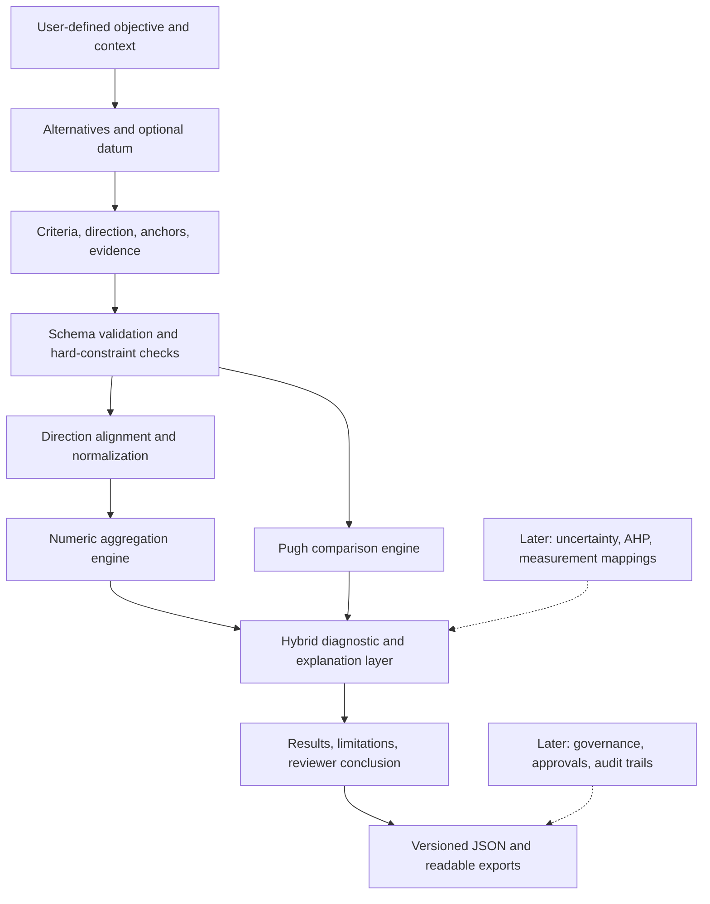

# Engineering Decision & Selection Explorer
## Comparative Aggressiveness Explorer — Product Architecture and Version Roadmap

| Field | Value |
|---|---|
| Document ID | CAE-ARCH-001 |
| Version / status | 0.1.0 / Product architecture proposal |
| Date | 2026-11-01 |
| Product family | Engineering Decision & Selection Explorer |
| Initial application | Comparative Aggressiveness Explorer (CAE) |
| Immediate delivery | CAE V0.1 |
| Companion charter | `01_PROJECT_CHARTER_V0.1.md` |

> **Architectural thesis:** Build one reusable **comparison and decision-record engine**. Keep methods, evidence, domain models, and governance as optional modules, so the initial lightweight tool can grow into a rigorous engineering evaluation environment without claiming unsupported certainty.

## 1. Portfolio positioning and scope

```text
Public Engineering Tools / Work
└── Engineering Decision & Selection Explorer  [portfolio family]
    ├── Comparative Aggressiveness Explorer     [first released application]
    │   ├── Pugh / datum comparison             [qualitative mode]
    │   ├── Arithmetic / weighted scoring       [numeric mode]
    │   └── Hybrid comparison review            [composite, not blended score]
    ├── Future: Criteria & Weight Explorer      [shared or separate front end]
    ├── Future: Worst-Case Selection Workflow   [evidence-linked template]
    └── Future: Trade-Study Decision Record     [controlled documentation]
```

CAE is **domain independent**. Materials, packaging constructions, process conditions, design alternatives, electromechanical products, or other items can be evaluated if they share one clearly stated comparison objective. Templates may be domain-specific; the core mathematics may not be.

**Relationship to other tool families:** The Risk/FMEA Explorer, Barrier Technology Explorer, DOE Navigator, Sustainability Explorer, and other calculators may eventually consume **decision records or templates** from this portfolio. They should not share unverified physical models or interpret CAE scores as an FMEA risk priority, actual permeability, qualification proof, or regulatory acceptance result.

## 2. Core architectural principles

1. **Meaning before math.** Objective, comparison direction, context, criteria, and scale anchors precede numeric entry.
2. **Explicit qualitative vs quantitative distinction.** Classical Pugh-style symbols are judgments relative to a datum; normalized scores are numerical constructs. Do not treat either as automatically true physical measures.
3. **No unsupported score blending.** A hybrid dashboard shows independent evidence channels and where they conflict; it does not add a `Pugh net` to a weighted average.
4. **Calculation engine is pure and testable.** Same schema, inputs, and engine version yield same results without web access.
5. **User-defined, not model-defined, criteria.** Tool cannot silently infer polymer behavior or generate material rankings from names.
6. **Constraint-aware.** Safety, functionality, or compatibility gates remain gates, not compensatory scores.
7. **Local-first and exportable.** Data are portable JSON; CSV/Markdown summaries support review and later migration.
8. **Versioned knowledge.** The record distinguishes source data, human judgments, formulas, computed results, and reviewer interpretation.
9. **Progressive rigor.** Higher versions add decision confidence, measurement support, uncertainty analysis, and governance without forcing complex workflow on introductory users.
10. **Human accountability.** Final engineering selection or worst-case designation is a reviewed decision, not an algorithmic assertion.

## 3. Conceptual architecture



### 3.1 Layer boundaries

| Layer | V0.1 responsibility | Expansion contract |
|---|---|---|
| Domain model | Assessment, objective, alternative, criterion, datum, scale, rating, weight, Pugh judgment | Add criterion hierarchy and decision scenarios |
| Validation | Structural integrity, type/range, missing inputs, gate status | Physical-unit validation, evidence requirements |
| Normalization | Invert criterion direction, map to [0,1] | User-defined value / utility functions |
| Numeric methods | Sum, arithmetic mean, weighted mean, exploratory raw product | AHP-derived weights, weighted geometric, TOPSIS, outranking |
| Pugh | Manual relative judgments and profiles | Multiple datums, convergence rounds, team consensus |
| Hybrid diagnostics | Direction disagreements and presentation | Stability and conflict diagnosis across methods |
| Decision record | Human conclusion, assumptions, limitation flags | Reviewer signoff, version history, traceability |
| Persistence / export | Browser-local data, JSON/CSV/Markdown | Optional secure synchronization, controlled repositories |
| UI | Mobile-friendly editable comparison matrix | Advanced visualizations and collaborative workspaces |

### 3.2 Stable engine interface

Each scoring method will implement a common contract:

```ts
type ScoreMethodId =
  | 'sum'
  | 'mean'
  | 'weighted_mean'
  | 'raw_product';

type MethodResult = {
  methodId: string;
  scoreByAlternativeId: Record<string, number | null>;
  contributionByAlternativeAndCriterion?: Record<string, Record<string, number>>;
  warnings: string[];
  engineVersion: string;
};

interface ScoreMethod {
  id: ScoreMethodId | string;
  evaluate(assessment: ValidatedAssessment): MethodResult;
}
```

**Important:** No result becomes decision-ready merely because it implements this interface. Each method requires an applicability statement and tests.

## 4. Three-mode product model

### 4.1 Mode A — Pugh (qualitative)

- Select a datum/reference candidate.
- On each criterion compare non-datum alternatives as more/same/less/unknown relative to the datum for the **defined aggressiveness objective**.
- Show the pattern, counts, rationale, and known uncertainties.
- Encourage synthesis or further measurement where strengths and weaknesses conflict.
- **No fabricated continuous score and no forced winner.**

### 4.2 Mode B — Numeric (quantitative scoring)

- Select a common rating scale, criterion directions, and method.
- Normalize all ratings to higher = more challenging on [0,1].
- Compute selected additive method; weights optional. Keep product as distinctly labeled exploratory mode.
- Show result calculation, contributions, eligible ranking, ties, hard constraints, and original scores.
- Use objective-language labels such as “more challenging under entered scoring assumptions,” not “proven worst case.”

### 4.3 Mode C — Hybrid (recommended, with appropriate data)

- Run both qualitative and numeric tracks on the same alternatives and criteria.
- Compare criterion-level relative directions against the datum; flag discrepancies rather than overriding judgments.
- Present separate qualitative and numeric sections and a short explanation to help the reviewer decide what to validate next.
- Encourage staged convergence: revise criteria or alternatives, run a new assessment version, preserve prior assumptions.
- **No formula `Composite = Pugh points + weighted score`**; the scales and semantics are incompatible without a new validated model.

## 5. Version roadmap

| Version | Product name / milestone | Capabilities | Mathematical / evidence basis | Release boundary |
|---|---|---|---|---|
| **V0.1** | **Configurable Comparative Screening** | User-defined alternatives and criteria; common custom scale; directional ratings; sum, mean, weighted mean; exploratory product; datum Pugh; hybrid disagreement; gates; local saving/exports | Explicit normalized arithmetic + separate manual Pugh | Deterministic, explainable prototype; no physical or regulatory prediction |
| **V0.2** | **Sensitivity & Robustness Explorer** | Weight what-if slider, perturbations, rank stability, top-two margin, scenario clones, criterion removal/leave-one-out, benchmark-change comparison | Deterministic sensitivity and rank-reversal analysis | Warn when selection changes under plausible assumptions |
| **V0.3** | **Advanced Decision Methods** | Pairwise criterion importance (AHP), consistency diagnostics, weighted geometric if appropriate, optional TOPSIS / outranking method with applicability gates | Explicit method assumptions; separate method outputs, not implicit blending | Comparison of methods with provenance and method-validity checks |
| **V0.4** | **Evidence & Measurement Integration** | Continuous measured values, units, user-defined score/utility mappings, cited data sources, confidence/evidence tags, calibration, domain templates | Traceable mapping from source measurement to score | No implied universal mapping; standardized example cases |
| **V0.5** | **Uncertainty & Group Review** | Interval ratings, Monte Carlo where legitimate input distributions exist, multi-reviewer disagreement, reviewer consensus, scenario ensembles | Distribution-aware / group-decision methods, with assumptions | Report uncertainty rather than single false-precision rank |
| **V1.0** | **Controlled Engineering Decision Record** | Reviewed baselines, immutable decision snapshots, approvals, changes, electronic record metadata as applicable, configurable QMS templates | Verified software requirements + controlled organizational procedures | May *support* a quality process only after documented validation and implementation controls |

### V0.2: sensitivity (initial equations)

Given normalized criterion ratings `aᵢⱼ` and nominal normalized weights `αⱼ`, define:

```text
Sᵢ(α) = Σⱼ αⱼ aᵢⱼ
αⱼ ≥ 0, Σⱼ αⱼ = 1
```

For a user-selected perturbation scenario `α'`, recompute scores and rank. **Rank stability** may be summarized as the fraction of *explicitly sampled, disclosed scenarios* in which each alternative is top-ranked. It is not a probability unless a justified probability model over weights exists.

Define nominal top-two margin:

```text
Δ = S_top − S_second
```

A large margin alone does not imply robustness if criteria are uncertain; rank stability requires examining specified weight/score perturbations. V0.2 should include leave-one-criterion-out analysis and a report identifying which criteria change the winner.

### V0.3: candidate methods and applicability

- **AHP:** pairwise comparisons for deriving criterion weights, with documented consistency diagnostics; do not treat preference strength as a measured physical sensitivity.
- **Weighted geometric aggregation:** `Gᵢ = exp(Σⱼ αⱼ ln uᵢⱼ)` for explicitly justified **strictly positive** commensurate utilities `uᵢⱼ`; never take `ln(0)` and never assume arbitrary ordinal categories are ratio data.
- **TOPSIS / distance-to-ideal:** candidate only after defensible distance and normalization assumptions are established; results presented side by side with additive scoring.
- **Outranking / veto approaches:** useful when large trade-offs or disallowed compensations exist; consider only with transparently defined preference thresholds.

### V0.4: physical data instead of arbitrary rank assignments

A numeric criterion may eventually be defined as a measured value `zᵢⱼ` with units and test conditions. A **user-approved, explicit mapping** `fⱼ(z)` maps measurements into normalized decision utility/challenge:

```text
zᵢⱼ [with unit, method, conditions, uncertainty] → fⱼ(zᵢⱼ) = aᵢⱼ ∈ [0,1]
```

These mappings must be criterion-specific, documented and bounded. For packaging barrier assessments, this would require compatible test conditions, relevant physical mechanism, thickness and environmental information, and source evidence. The CAE must never silently infer such a mapping from material names.

### V0.5: uncertainty and reviewer disagreement

- Use ranges where input judgments are uncertain; preserve interval or distribution assumptions.
- Run scenario or Monte Carlo analysis only if sampling distributions and dependence assumptions are defensible.
- For group ratings, show differences and rationale; do not automatically average contradictory assessments into a false consensus.
- Avoid equating “fraction of sampled scenarios” with calibrated event likelihood absent a probabilistic interpretation.

### V1.0: scope of controlled engineering use

V1.0 can offer traceability, access control, review records, version history, and reproducibility. **These software features alone do not establish** ISO 14971 compliance, ISO 11607 conformity, software validation, FDA acceptance, or approval for safety-critical decisions. Any controlled organizational use requires a separate intended-use assessment, applicable validation, documented processes, and authorized review.

## 6. Data and API evolution strategy

### 6.1 Versioning

- Maintain separate `schemaVersion`, `engineVersion`, and `appVersion` fields.
- Bump schema version whenever persisted semantics change; define explicit migration routines.
- Preserve old files; never silently rewrite or upgrade externally provided assessment evidence.
- Use stable alternative/criterion IDs; display names are mutable.
- On import, show compatibility/migration results and rebuild computed outputs using the current selected engine.

### 6.2 Record separation

```text
AssessmentDefinition
  objective + context + alternatives + criteria + scales + weights + datum
UserEvidence
  raw ratings + Pugh judgments + references + assumptions + gate claims
CalculationRun
  method + engine version + outputs + warnings + input hash (future)
ReviewDecision
  reviewer conclusions + reasons + unresolved questions + approvals (future)
```

Do **not** collapse all four into a single mutable result field. A later reviewer should distinguish an input judgment change from an arithmetic implementation change.

### 6.3 Templates

Potential templates are **starter criteria sets** only, never truth tables:

| Template | Example criteria | Required caution |
|---|---|---|
| Barrier challenge screening | Assigned transmission challenge, environment sensitivity, geometry | Actual WVTR/OTR needs measurements and comparable conditions |
| Distribution challenge selection | Vibration exposure, drop exposure, load/stacking | Mixed physical units require explicit mappings |
| Process condition comparison | Temperature exposure, dwell, variability | High/low challenging conditions depend on process response |
| Concept selection | Manufacturing feasibility, assembly complexity, testing difficulty | Pugh 'more aggressive' differs from traditional 'more desirable' |
| Sustainability opportunity | Avoidable mass, implementation complexity, validation impact | Not a lifecycle impact or CO₂ calculator without measured inputs |

Templates should permit deletion/modification of all user-definable variables and should display sample-data provenance.

## 7. Proposed codebase organization

```text
comparative-aggressiveness-explorer/
├── index.html
├── package.json
├── public/
│   └── examples/synthetic-moisture-comparison.json
├── src/
│   ├── domain/types.ts
│   ├── domain/schema.ts
│   ├── engine/normalize.ts
│   ├── engine/methods/sum.ts
│   ├── engine/methods/mean.ts
│   ├── engine/methods/weightedMean.ts
│   ├── engine/methods/exploratoryProduct.ts
│   ├── engine/pugh.ts
│   ├── engine/hybrid.ts
│   ├── engine/ranking.ts
│   ├── validation/constraints.ts
│   ├── persistence/localStore.ts
│   ├── export/json.ts
│   ├── export/csv.ts
│   ├── export/markdown.ts
│   └── ui/
├── tests/
│   ├── engine/
│   ├── schema/
│   └── integration/
└── docs/
    ├── PROJECT_CHARTER_V0.1.md
    ├── ARCHITECTURE_AND_VERSION_ROADMAP.md
    └── FORMULAS_AND_LIMITATIONS.md
```

**Technology choice:** TypeScript with a lightweight browser UI and pure functions is recommended; React, Svelte or vanilla DOM are implementation options rather than architectural dependencies. A static site is sufficient for the V0.1 scope and can be hosted on GitHub Pages. IndexedDB or localStorage may be used according to record size and testing; exports remain the portable source of truth.

## 8. Usability architecture: beginner vs advanced

**Simple path (default):** Objective → Alternatives → Criteria → 0–5 scale → Equal-weight arithmetic mean → Result, with rationale and limitations.

**Advanced toggle:** Choose datum/Pugh/Hybrid → custom scale and anchors → weights → product exploratory mode → constraints → evidence details → detailed report.

This keeps V0.1 usable for quick screening while exposing advanced functionality to users who need it. The tool should provide an unambiguous “How was this calculated?” expansion for every result and a plain-language “What this does *not* establish” section.

## 9. Cross-cutting design requirements

- **Scientific accuracy:** never use unexplained heuristics as physical equations.
- **Terminology:** more aggressive = defined challenge direction; not automatically more dangerous, more risky, less desirable, or less compliant.
- **Traceability:** record scale anchors, rating direction, datum identity, weights, evidence source, method, version, and rationale.
- **Validation:** every release requires mathematical regression tests and representative manual worked examples.
- **Missing data:** no silent normalization, default zero, implicit 'same', or fabricated completions.
- **Security/privacy:** local-first, no telemetry by default, no external proprietary-data uploads; future cloud features require security review.
- **Accessibility:** readable matrices on phone, table labels, no color-only score meaning, keyboard interaction.
- **Interoperability:** JSON as authoritative interchange; readable CSV/Markdown as supplementary exports.
- **Communication:** prototype/validated-use distinction must remain visible on the public site.

## 10. Release gates and version dependencies

| Transition | Required prerequisite | Objective evidence |
|---|---|---|
| V0.1 → V0.2 | Stable schema and test suite | Reproducible baseline calculations |
| V0.2 → V0.3 | Sensitivity semantics and applicability checks | Known test cases with rank changes |
| V0.3 → V0.4 | Method selection rules and separate model adapters | Verified numerical calculations and unit-aware examples |
| V0.4 → V0.5 | Evidence metadata and value mappings | Traced source inputs and uncertainty definitions |
| V0.5 → V1.0 | Traceable records, governance model, software QA plan | Documented intended use, verification and validation appropriate to deployment |

**Avoid this antipattern:** Do not add five different ranking algorithms merely to show five “votes.” If their scale assumptions are invalid or their results are strongly correlated, additional methods can create an illusion of rigor rather than a better engineering decision.

## 11. Forward backlog, prioritized

| Priority | Feature | Target |
|---|---|---|
| P0 | Scoring model, Pugh datum logic, hybrid independent display, explanation | V0.1 |
| P0 | Hard-gate and missing-data safeguards | V0.1 |
| P0 | User-owned comparison matrix, custom common scale, weights | V0.1 |
| P0 | Import/export and deterministic regression tests | V0.1 |
| P1 | Weight perturbation and rank-stability explorer | V0.2 |
| P1 | Criterion dependency / double-counting review aid | V0.2–V0.3 |
| P1 | Multi-datum Pugh and controlled convergence iterations | V0.3 |
| P2 | AHP and other justified multi-criteria methods | V0.3 |
| P2 | Physical measurement adapters and public-source templates | V0.4 |
| P2 | Review/uncertainty/consensus controls | V0.5 |
| P3 | Controlled signoff/synchronization / organization integrations | V1.0 |

## 12. Decisions still open (do not block V0.1 implementation)

- Whether the brand-facing name is **Comparative Aggressiveness Explorer**, **Challenge Selection Explorer**, or **Worst-Case Screening Explorer**. Engineering name CAE can remain stable.
- Whether separate product templates are hosted as JSON files or delivered as in-app starters.
- Whether V0.2 supports a fixed default ±10% weight perturbation or only user-configured perturbations (recommend user-configured).
- Whether future evidence links are imported via manual URLs, file attachments, or a controlled registry.
- Whether a future controlled use case exists that warrants QMS-specific validation and approval workflows.

## 13. Evidence and reference basis

1. ASQ, **Decision Matrix / Pugh Matrix** — https://asq.org/quality-resources/decision-matrix
2. Frey et al., **Pugh Controlled Convergence**, *Research in Engineering Design* — https://link.springer.com/article/10.1007/s00163-008-0056-z
3. NASA, **Systems Engineering Handbook, Trade Study definition** — https://www.nasa.gov/reference/system-engineering-handbook-appendix/
4. NASA, **Decision Analysis** — https://www.nasa.gov/reference/6-8-decision-analysis/
5. ISO, **ISO 14971:2019** — reference for the distinction between formal device risk management and generic decision matrices; not a CAE conformance claim. https://www.iso.org/standard/72704.html

---

**Near-term implementation directive:** Start coding only the V0.1 modules; keep the generic engine and schema extensible. Use the project charter as the acceptance-test contract. Do not implement future methods as placeholders that appear functional to users before their applicability checks and numerical tests exist.
